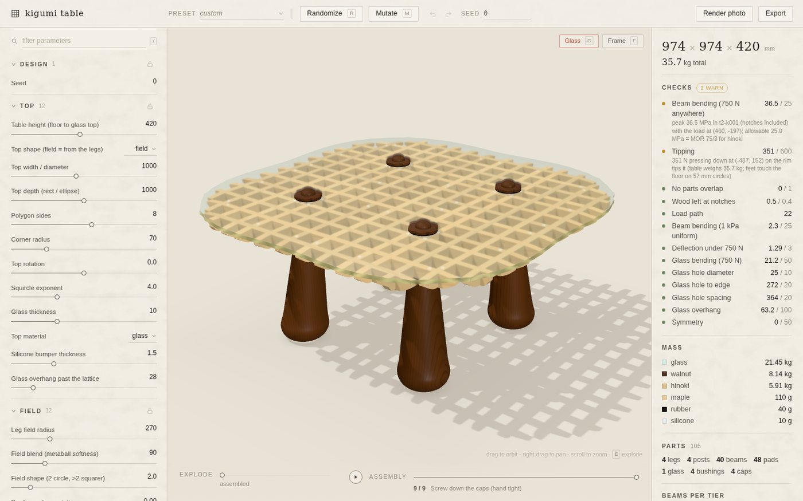
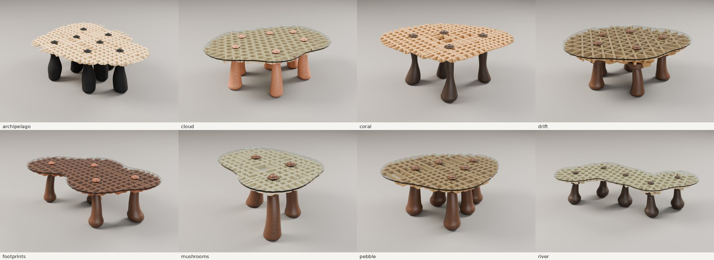
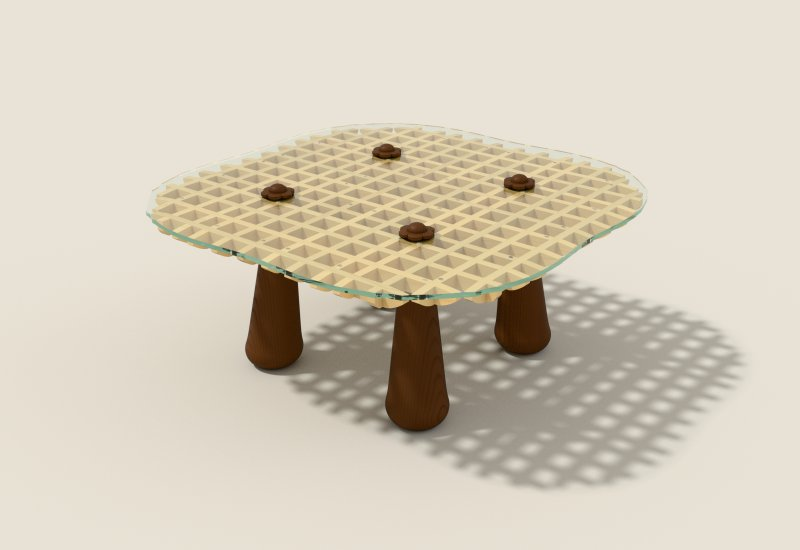

# kigumi table

Generative, nail-free coffee tables in the spirit of Japanese joinery (*kigumi*, 木組み). Pick
legs, a field, a grid; the program lays out a flat lattice of notched strips, works out every
joint, checks that the table stands up, and writes the files a workshop needs to make it.

**[Open the configurator →](https://huntrontrakkr.github.io/kigumi-table/)** It runs entirely in your
browser, phones included: the Python design engine and its structural solver in WebAssembly, the
renderer and the photo path tracer on your GPU (WebGPU).



* **Legs** are turned, almost straight stems with a fat rounded foot and a flared capital. They can
  stand on a ring, a square or a rectangle, or on organic layouts: a sunflower spiral, scattered
  points, a meander, or points you type in. Each leg can also vary on its own.
* **Radiance field.** Every leg radiates a circular field. The fields combine with a smooth
  minimum (2D metaballs, like smooth union in an SDF shader), so one leg alone makes a perfect
  circle and neighbouring legs fuse into one organic blob. That contour is the glass outline.
* **Lattice.** Thin strips are notched into each other so the top is one flat plane (a kumiko-like
  grid): squares, kagome hexagons and triangles (two strips per crossing), or a mitsukude triangle
  grid (three at every node). Under it, bracket tiers (tokyō, 斗栱) step out from the legs, chosen
  by load (see below).
* **No glue, no nails.** Every joint is a lap, slot or hole derived automatically. Each leg's
  threaded post rises through an open shaft in the grid (an igeta, 井), through the glass, and a cap
  (rokuyō flower, dome, hōju jewel, mushroom, octagon roof) screws down and clamps the whole stack.
* **Structure decides.** The top is solved as a plate under a person's weight placed all over it.
  The grid turns to the direction that needs the least strip. The bracket tiers hold the lines
  that carry the most bending: the lowest tiers take the main load paths, and every tier up adds
  the next. Checks (grillage finite elements with the glass as a real plate on its pads, notch
  depths, tipping, glass rules) put numbers on every design.



## The browser build

`site/` is static files (GitHub Pages serves it). Nothing runs on a server:

* **Engine.** The Python package runs in a Web Worker under [Pyodide](https://pyodide.org) (CPython
  compiled to WebAssembly) with numpy, scipy, shapely and contourpy. The first visit downloads about
  40 MB; later visits come from the browser cache.
* **Solids.** [Manifold](https://github.com/elalish/manifold)'s WebAssembly build makes the solids and
  booleans; `kigumi/_m3d_web.py` shims the subset of the `manifold3d` API that the package uses.
* **Solver.** The structural systems (the glass plate, the grillage with its contacts) are solved
  by SuperLU in WebAssembly. A WebGPU solver is included too (`site/engine/gpu/`): conjugate
  gradients in WGSL with a sparse approximate inverse preconditioner, refined to double precision on
  the CPU, Python waiting on the GPU through JavaScript Promise Integration. Measured on an RTX 3090
  it is 3–9x *slower* than SuperLU on these systems (a fourth-order plate needs CG iterations in
  proportion to its size, while a sparse Cholesky of a 2D mesh stays cheap), so it is off unless
  you add `?gpu-solver` to the address. `tools/gpu-test/NOTES.md` has the numbers.
* **Rendering.** three.js `WebGPURenderer`, with the procedural wood written in TSL (compiled to
  WGSL, or GLSL on the WebGL2 fallback). **Render photo** path-traces the scene on the GPU
  (`site/render/`): a WGSL megakernel, a binned-SAH BVH built in a worker, and the wood ported to
  WGSL. 1600 x 1100 at 256 samples takes about 4.5 s on an RTX 3090. Slower GPUs stop at a 15 s
  budget, phones render 1200 x 825, and without WebGPU the photo is a rasterised still.
* **Export.** The fabrication package comes as a zip: CNC strip sheets (DXF), glass DXF,
  drawings, cut list, `FABRICATION.md`, GLB and STL. STEP and Rhino `.3dm` come from the Python
  package on your own machine.



Tested in Chrome on Windows (WebGPU on an RTX 3090) and, headless, in Firefox, in WebKit
(Safari's engine) emulating an iPhone, and in Chromium emulating Android phones. Browsers without
JavaScript Promise Integration (Safari, Firefox) call Python directly. Without WebGPU the view falls
back to WebGL2, and **Render photo** to a rasterised still. On a phone:

* the panels open as sheets from a tab bar;
* a tap on a part inspects it;
* the view lowers its resolution if frames come slowly.

A design change takes a few seconds on a desktop; phones take longer.

Develop locally: `uv run python scripts/build_site.py` (packs the Python sources into
`site/py/kigumi.zip`), then serve `site/` with any static server, e.g. `python3 -m http.server -d site`.
Other tools:

* `tools/web-engine-test/run.mjs` runs the same engine under Node.
* `tools/gpu-test/` tests the GPU solver, and `tools/pathtracer-test/` tests the path tracer.
* `tools/ui-test/mobile-smoke.mjs` drives the page as an iPhone (WebKit) or an Android phone
  (Chromium) by touch.
* `tools/win-chrome/` starts a headless Chrome on the Windows host of a WSL2 box with its own
  profile, and drives it over DevTools, for tests on the real GPU.

## Run locally (Python)

```bash
uv run python -m kigumi.server            # the same page at http://localhost:8765, on native Python
uv run python scripts/render_one.py temple-round hero top     # Blender Cycles renders
uv run python scripts/sheet.py out/sheet.png hero '{}' '{"leg_count":3}'   # side-by-side variants
uv run python scripts/plan.py out/plan.png '{}' '{"leg_count":1}'          # plan diagnostics (fast)
uv run python scripts/partition.py out/p.png '{}' '{"preset":"field-pedestal"}'  # the kd-tree, strips by level
uv run python scripts/organic.py out/organic 4                    # asymmetric organic designs, rendered
uv run python scripts/gallery.py out/gallery.png 6               # search + render 12 sound designs
uv run python scripts/sweep.py 40                                 # robustness: build + check many
```

Served by `kigumi.server`, the page uses the server instead of starting the in-page engine: builds
run natively, **Render photo** uses Blender Cycles when Blender is installed, and the export adds STEP
and Rhino `.3dm`.

Python: `from kigumi.params import Params; from kigumi.build import build; d = build(Params(leg_count=3))`,
then `kigumi.fab.export_all(d, "out/export/mine")` for the fabrication package.

## Pipeline

1. **Field** (`field.py`): per-leg signed distances, exponential smooth-min, marching squares to
   plan polygons. The field grows its radius automatically until the lattice level is one piece,
   so legs always join through a neck at least a cell wide.
2. **Plate** (`plate.py`): the top is solved as a Kirchhoff plate (bicubic Bogner-Fox-Schmit
   elements on a grid over the outline), held at the leg capitals. It is loaded with 1 kPa, and the
   design load as a hand-sized patch at about a hundred places. A grid of straight strips carries
   the plate's moments in its own directions, so each strip family's design moment is Wood-Armer's
   `m_u = |M_uu| + |M_uv|`, enveloped over the load cases.
   * **Grid angle.** With `orient = "load"`, the square grid takes the angle with the least total
     demand, among the angles that keep the legs' symmetry. For four legs on a square that means
     choosing between 0 and 45 degrees.
   * **Strip spacing.** The demand also sets the spacing (next step).
3. **Layout** (`layout.py`): tiers of beams grow from the legs. A candidate line is kept only if it
   rests on two earlier beams (a leg capital counts as two), each reachable within its cantilever
   limit. Lines of a parallel tier at the same height either stack (a bracket arm under its beam)
   or keep clear.
   * **Uniform top, tiered brackets (`spacing="uniform"`, the default).** The top grid is
     even, laid through the lines framing the posts. The bracket tiers below are chosen by load
     (`tier_load`): each tier keeps its share of the grid lines that carry the most bending along
     their length (the plate's design moment for that direction). The lowest tiers hold the main
     load paths, and the arms reach only as far as the bending does.
   * **Tree spacing (`spacing="tree"`; `partition.py`).** The flat top is a kd-tree of
     cells. The lines framing the posts are the roots. A cell is split across its longest side while
     it is wider than the local target. That target follows a fully stressed grillage: strips are
     spaced inversely to the moment they carry, `s = pitch (m_ref / m)^load_refine`. Strips end up
     dense around the legs, where the top bends most, and open in the middle and at the free rim.
     `rim_refine` adds boundary refinement as an effect. Each split line spans only its own cell and
     ends on that cell's sides with an end lap. A strip is placed once it rests on two placed parts,
     a whole symmetry orbit at a time, so the result is exactly symmetric whatever the order.
   * **Bracket tiers.** These hold the partition's coarse levels plus a tip as far out as each
     tier can reach.
   * `spacing="split"` (full lines from a 1D dyadic partition) and `spacing="field"` (a smooth
     density field) remain.
   * **Ends.** Ends are cut to the last joint plus a projection with a curved *kurikata* underside.
     Strips that touch without crossing cleanly are extended or cut back, all at once.
   * **Tier count.** Bracket tiers are added (up to 3 more than asked) until the top grid fills the
     field and a quick grillage run says the lattice carries the design load.
4. **Joinery compiler** (`joinery.py`): for every pair of parts whose footprints and heights
   overlap, one relation is chosen. *split(z)*: the earlier part keeps the wood below z and the later
   part the wood above (laps, capital slots, masu seats). *pin*: a hole. *blind*: the cap's threaded
   hole. Because earlier parts are always below later ones wherever they share plan area, the parts
   drop in, in order, without collision. Split heights are then optimised so no strip is starved
   where it is notched from above and below.
5. **Solids** (`model.py`): manifold3d meshes (fast, exact booleans). `fab.export_step` rebuilds the
   same nominal solids and cuts as OpenCascade B-rep for STEP.
6. **Checks** (`checks.py`), each with numbers:
   * parts don't overlap;
   * parts drop in, in order;
   * enough wood is left at notches;
   * grillage FE with compression-only lap contacts, to find load-path mechanisms, beam bending
     (notches included) and deflection under a point load moved over the top and a uniform load.
     The glass is a real plate (the same elements as `plate.py`). It rests on its silicone pads
     (compression only) and is held at each post by the cap clamp. So overhangs and spans are judged
     by the glass's own bending stress;
   * glass hole rules;
   * tipping load.
7. **Search** (`search.py`): Randomize evaluates a dozen candidates in parallel and keeps the
   soundest (the Galapagos step of the Grasshopper analogy).

## Legs

The stem profile is continuous, so the configurator and the random search can mix any of these:

* a straight taper;
* a mushroom flare;
* a movable belly bump: positive gives gourds and spindles, negative gives an hourglass waist;
* a bun bulge at the foot;
* a rolling-ball fillet that rounds the foot on any stem. It keeps a flat at least 35% of the foot
  radius, so the leg doesn't rock.

`leg_style` picks a named setting of those controls: taper, mushroom, bun, gourd, spindle, hourglass or
bulb. `leg_sweep` and `leg_swirl` bow the stem outward or sideways. Splayed legs default to
`leg_splay="tilt"`: a straight turned leg set at an angle, which stays lathe work.

## Sending it off to be made

`FABRICATION.md` in every export says who makes what and from which file:

* **Lattice strips:** a CNC router shop. `cnc_strips.dxf` nests every strip profile on standard boards
  with the grain along the length. Inside notch corners get dogbone reliefs for the shop's bit
  (`tool_d`), and every strip is labelled. A woodworker can also cut them with a dado stack; the cut list
  groups identical strips.
* **Legs and caps:** a woodturner, using the full-size turning template and the capital-slot plans in
  `drawings.pdf`.
* **Posts:** separate hard-maple dowels with wood threads (`post_mode="dowel"`).
* **Glass:** a glass shop, cutting to `glass.dxf`, drilling before tempering and polishing the edge.

`FABRICATION.md` also lists the tolerances (cut a test joint first; `clearance` is 0.15 mm a side),
the check results and a rough one-off cost with its inputs.

## Outputs (`fab.export_all`)

| file | contents |
|---|---|
| `table.3dm` | native Rhino 8 file with layers and per-part user text |
| `table.step` | B-rep solids |
| `table.glb`, `table.stl` | meshes |
| `glass.dxf` | full-size glass outline and holes |
| `beams.dxf` | every beam's side profile with notches and curved ends |
| `cutlist.csv` | stock list; identical beams are grouped |
| `cnc_strips.dxf`, `cnc_strips.pdf` | nested CNC cut sheets with dogbones and labels |
| `drawings.pdf` | overview, tier plans, beam elevations with notch tables, full-size leg turning template, capital-slot plans |
| `FABRICATION.md` | who makes what, tolerances, checks, rough cost |
| `assembly.md` | the order in which parts drop in |
| `report.json` | the full checks |

## Glass over the tails

With `glass_cover` (the default), the glass runs 10 mm past the field outline and the eave tails
tuck in under its edge. They stay just clear of it (`tail_drop`), so they are protected and carry
nothing. The glass carries the edge loads itself; the plate check gives that stress.

## Hex grids

The hex grid is a kagome: three families of strips 60 degrees apart, laid so that no three pass
through one point. Every crossing is then an ordinary two-strip half lap. The same rule means a
kagome cannot be refined locally:

* halving it, or nesting a finer one inside, always creates three-strip points;
* so does warping its spacing.

That is why hex tops stay at one even pitch, with the structure in the bracket tiers underneath.
Their grid direction is chosen from the two that keep the legs' symmetry, whichever seats the posts
in cells.

`hex_joint="mitsukude"` is the other way: a triangle grid with three strips crossing at every node,
as in kumiko *mitsukude* work. Each strip keeps a third of its depth there, so the joints are
weaker (the notch check says so). The posts rise through triangles.

`hex_motif` ("star" or "ring") is an experiment: it refines whole hexagons in place, which keeps
every joint two-way. With 18 mm strips it needs a kagome pitch near 190 mm, too coarse for a
one-metre top.

## Notes and limits

* Thin hinoki strips are marginal under a 750 N rim load. The checks say so; stronger woods
  (oak, ash) or deeper strips pass. The presets pass with warnings at most.
* The tree's dyadic splits make `pitch` move in steps: a small change can add or remove a whole
  level of cells.
* The radial (pinwheel and ring) grammar predates the open-shaft leg joint, so it is left out of
  random sampling.
* **Organic layouts need checking.** Spiral, scatter, wave and free layouts are asymmetric by
  nature. Where the outline reaches far past the feet, the table can tip under a hand on the rim,
  and the tipping check flags it. Pull the field in, lean the feet out, or add a leg.
* Front-end tests, all in `tools/ui-test`:
  * `node ui-test.mjs --url http://127.0.0.1:8765/ --quick`: the local server.
  * `node site-smoke.mjs --url http://localhost:8790/ [--browser firefox|webkit]`: the browser build.
  * `node mobile-smoke.mjs --browser webkit|chromium [--landscape 1] [--export 1]`: phones.

  On Linux, WebKit needs its system libraries. Set `PLAYWRIGHT_SKIP_VALIDATE_HOST_REQUIREMENTS=1`
  if they are installed somewhere private.
* Wood moves across the grain, so notches are cut with 0.15 mm clearance a side and the caps can be
  re-snugged seasonally.

## Credits

three.js (MIT), Manifold (Apache-2.0), Pyodide (MPL-2.0) with numpy, scipy, shapely and contourpy
(BSD). The Python package also uses build123d, rhino3dm, ezdxf and matplotlib for the local
fabrication exports, and Blender for offline renders.

## License

MIT. See [LICENSE](LICENSE).
